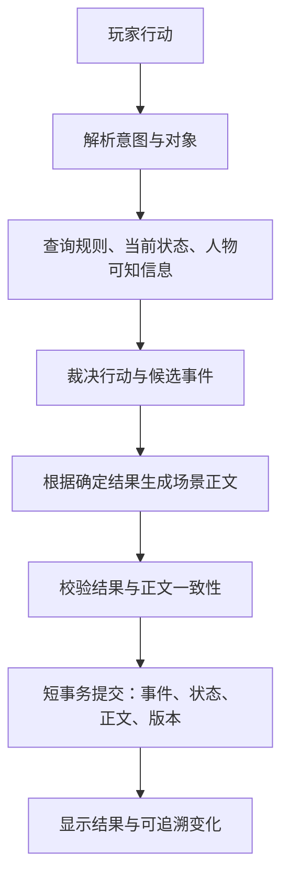

# 双界录：重构方案与开源参考

日期：2026-10-18。性质：设计建议，不是已实施功能，也不替代 RULES.md 中已经定案的规则。

分阶段任务、依赖与验收见[详细实施计划](IMPLEMENTATION-PLAN-2026-10-18.md)。

后续已根据用户确认的高自由度、持续世界与离线自主行动方向更新为[自由沙盒设计](SANDBOX-DESIGN-BRIEF-2026-10-18.md)，产品定位和首版验收以该文为优先。

本轮检查了本项目的规则、世界观、回合结算和记忆实现，并检索了外部项目的官方仓库、许可和部分源码。没有逐一部署外部游戏，其 README 中的功能声明不能视为体验或可靠性验收。

## 1. 判断与产品方向

上一轮修复解决了存档、数值结算、信息展示和阅读体验中的具体错误，没有解决故事设计与长期世界模拟的问题。现在更接近“带状态面板的 AI 续写原型”，离能长期游玩的单人叙事 RPG 还有一段距离。

建议确立三个职责：作者设计值得经历的冲突，程序裁决行动及后果，AI 演绎人物和场景。保留自由输入、随时免费双穿、境界成长主干、不强制解释系统身世；在其上增加可以选择、拒绝、失败和回收的章节故事。

首个可交付版本限制在青临市的学校与家庭、白溪镇及周边，6—8 个核心人物、8—12 个可互动地点，一章约 30—50 次有效行动。九州继续作为背景，暂不承诺所有区域都能深度模拟。

核心体验应是：玩家做一件事，世界因此发生可理解的变化；人物记得这件事，并据此改变之后的选择。

## 2. 当前缺口及证据

| 方面 | 当前实现 | 造成的体验问题 |
|---|---|---|
| 剧情 | app/models.py 的 refresh_main_quest 按境界派生目标 | 成长目标稳定，但升级进度不能独自提供冲突、悬念与阶段结局 |
| 裁决 | app/engine.py 的 take_turn 接收同一份模型输出里的正文和状态修改，再校验结算 | 模型先写成买到了、打赢了，再被规则拒绝，整回合只能退回；叙事与真实结果容易脱节 |
| 人物 | 好感数值、人设、关系描述及短记忆为主 | 缺少独立目标、行动条件、知识来源与利益冲突，容易围着玩家转 |
| 记忆 | npc_remember 保留近期 6 条和行事录 20 条；事实账本硬上限 60 | 这是有限窗口，不能称为完整终身档案；极端情况下未结承诺也会被淘汰 |
| 检索 | app/memory.py 按行动中明确出现的实体名，搜索最后 200 条归档，取最后 3 个命中片段 | “他”“之前那件事”、别名及更久的旧事容易漏检，片段开头也未必包含相关证据 |
| 时间 | 已有离线流速换算，没有完整的回合内游戏历法 | “闭关三月”、赶路、约会期限、两界日程难以一致结算 |
| 世界 | 地名、宗门与资源原则较齐全，许多约束仍靠提示词 | 距离、库存、情报传播和势力行动不能稳定约束剧情 |
| 存储 | JSON 主存档加正文/NPC 归档，已补备份和锁 | 可靠性已有改善，但按人物、事件、世界时间查因果和隔离周目仍不方便 |

已做过的信息展示隔离、交易预校验、备份恢复和版本检查应保留。下一阶段应解决这些深层缺口，不再仅扩大提示词或增加面板。

## 3. 剧情：境界主干之外，增加条件事件与章节结局

“渡劫飞升”继续作为长线成长目标。另设章节事件与人物事件，不让模型随意改写已经定案的成长主干。

每张事件卡至少包含：唯一编号、前置条件、参与者及各自诉求、触发地点和时间、可见线索、截止时间、解决条件、失败或拒绝后的发展、资源与关系后果、后续回收点、互斥条件与冷却。

事件不是只允许点三个选项的固定分支。玩家可以自由行动，但行动必须作用于真实对象，由规则判断能否改变事件状态。事件允许未触发、进行中、解决、失败、过期等状态；“没有接受任务”和“世界停止发生这件事”应当分开。

建议第一章样例：白溪镇的药材供应中断。药铺想尽快补货，采药人家属想找人，地方势力想控制通路，玩家需要取得安身和修行资源。可以护送、谈判、查证或做一笔有代价的交易；不参与时，供应和相关人物也沿有限计划变化。都市侧可以同时有一次已经答应的学校或家庭安排。这个样例尚未写入正典。

节奏调度只做有限工作：挑选当前条件满足的事件，控制同场人物数量、紧张事件密度、旧承诺回收和休息场景。不要每回合都新增神秘人、追杀者和远古秘密。人物拒绝、任务失败、问题暂时搁置，也应能得到完整可读的场景。

剧情设计应有三条相互影响的轨迹：成长、关系、地方局势。单独追求任一轨迹都能玩，不强制每个人物都参与系统身世谜题。

## 4. 世界观：补可执行边界，保留核心幻想

### 时间与生理年龄

现有 24 倍流速本身可以成立，问题是缺少统一结算。建议引入共享基准时间：都市推进 ΔT，玄灵界推进 24ΔT；行动先计算所在世界的耗时，再换算基准时间，同时更新另一界的日历。例如玄灵界行动一天，对应都市一小时。不能把一句“闭关三月”只当正文而不推进时钟。

主角生理年龄、疲劳与伤势，应按其亲身经历的时间处理，世界日历不能自动等于主角年龄。长时间修炼如何延寿应有明确境界规则。离线是否继续推进、离线结算上限及超过上限的处理需要作为明确产品规则，不能静默丢掉时长；行动时间和现实离线时间要防止重复结算。这些是待定方案，不是本轮擅自改动的规则。

### 免费双穿与危险

保留随时免费双穿及落点守恒。这样主角拥有很强的自救能力，应承认这一能力，而不是临时宣布空间被封禁。张力来自留下的同伴、带不走的目标、持续的伤势、被监视的返回点、约定期限和地方利益变化。逃走可以成功，事情未必因此解决。

### 携带、贸易与科技

先确定能携带什么、容量如何计算、活人能否通过、通信是否跨界、储物空间与穿越的关系。交易采用有限库存、地方需求和补货周期；少量试卖与大规模运输的价格和关注程度应不同。不要仅用单回合奖励上限代替世界经济。

现代技术可以创造优势，但先进物品不自动等于拥有制造、维修、供电、供应链和当地销路。都市异常能力的影响根据目击者、证据和传播链逐步发生，不能一出现能力就全社会知情，也不能永远无人注意。

### 地理、势力与开局

先做地方节点图：相邻地点、旅行时间、道路危险、势力控制、补给与营业时间。远方九州维持留白，不让随机续写擅自定死全局设定。

上品功法与十次抽奖可以保留；“白手起家”应准确解释为缺少当地人脉、庇护和物资。功法品阶决定潜力，不等于已经掌握相应力量。避免一边宣称主角毫无优势，一边频繁赠送足以绕过早期挑战的奖励。

## 5. 人物：从好感容器变成有诉求的行动者

核心人物使用结构化档案：稳定价值观、欲望、底线、说话习惯、社会关系；当前目标、期限、资源、位置、日程、已知信息和误解；以及与玩家的信任、亲近、戒备、利益或人情债。

多维关系用于解释行为，不必全部显示为数值。好感高不代表愿意泄密，信任高也不代表会牺牲自己的目标。人物改变立场应有事件依据，性格不能因一次聊天随机重写。

行为流程是“自己的目标与已知情况 → 可行行动 → 规则结算 → 对外表现”。只有场内人物、到期计划和受到事件影响的人物需要更新，不必每回合调用模型模拟全世界。普通商贩先用模板和营业规则，真正反复互动后再升级为完整档案。

每个人物、地点、独特物品都使用稳定 ID，姓名和别名仅用于显示与解析。不同周目、读档分支必须隔离，不能凭同名就恢复成同一人。

## 6. 记忆：事实、知情、误解和承诺分开保存

| 数据层 | 保存什么 | 更新原则 |
|---|---|---|
| 当前权威状态 | 位置、持有物、境界、伤势、任务阶段、时间 | 通过规则结算修改 |
| 事件日志 | 谁在何时何地做了什么，造成什么结果，谁见证 | 追加保存；更正以新事件表示 |
| 人物知识与信念 | 某人知道或相信什么，来自目击、转述还是推断 | 按人物授权访问，允许有误或被修正 |
| 承诺与剧情线 | 承诺对象、条件、期限、兑现证据及状态 | 独立状态机，不靠关键词猜“已解决” |
| 情节摘要与检索索引 | 面向上下文的压缩视图 | 可以重建，不作为最终事实来源 |

例如主角私下答应甲保密，乙未在场。该事件可以存在世界日志中，但乙的上下文不能得到它。后来甲向乙转述，才产生新的获知事件。如果转述是假话，记录的是“乙听到并相信某说法”，不能把说法升级成客观事实。

检索先按周目、分支、人物和可知范围过滤，再按当前场景、实体、目标、未结事项、相关性、时效与重要性排序。代词解析要结合当前在场人物和最近对话；歧义明显时不能默默认错人。每条注入的记忆保留事件来源，便于回查。

第一版先用结构化查询、别名和全文检索，测出语义漏检后再加向量检索。向量库解决“找得像”，不能替代“真假如何确定”和“谁有权知道”。正文归档保留，但不能只用正文摘要承担游戏账本。

世界事件和未结承诺不因提示词预算紧张被删除；只限制一次送进模型的数量。旧伤被治好后保留历史事件，当前状态改为已恢复，检索不得把旧伤重新当成现状。

## 7. 架构：先确定结果，再生成正文

自由行动解析和 AI 生成内容都只是提案，没有直接修改余额、身份、物品归属或正典的权限。简单购买、移动、装备等使用确定性命令；复杂行动需要模型解释意图时，先生成受限动作，再由规则裁决。模型可以创造经过边界检查的新细节，新角色和新地点在提交前只是候选对象。

不可行的行动应产生合理反馈，例如钱不足时商贩拒售、目标不在场时无法当面对话。它们是可解释的游戏结果，不应全都成为技术错误。是否消耗时间按动作规则处理。

数据库事务不跨越模型等待。保存待处理回合的 action_id 与基准版本，生成结束后在短事务内检查版本并一次提交。失败重试复用同一行动标识，防止重复扣钱和重复奖励；更换正文不能再次执行同一行动。必要时用模板正文保留已经裁决的结果，避免模型不可用导致整局不可玩。

一致性检查分两层：位置、归属、数值、知识访问范围等由程序验证；口吻、暗示泄密、因果合理性等用样例评测和人工复核。不要声称再加一个模型审查就能保证所有正文绝不矛盾。关键后果应在确认后展示，流式阅读不能先把未经裁决的成功结果发布给玩家。

## 8. 技术取舍与数据结构

保留 Python/FastAPI。采用单体应用，按领域拆分职责，不急于引入微服务或多个自主代理。建议模块：规则与行动、世界时间与地图、章节调度、人物状态、记忆查询、叙事生成、模型适配、存储。

SQLite 作为本地单人版本的主存储，JSON 保留为导出和迁移格式。建议实体包括 campaigns、branches、entities、actor_state、relations、events、knowledge、commitments、storylets、turns、snapshots。事件带 sequence、game_time、actors、location、payload、witnesses、caused_by、rule_version；随机结算记录种子或结果，使确认过的事件可以重放。

先做当前状态表加追加事件日志与快照，不必一开始实现全套复杂事件溯源框架。跨存档分支的索引和后台摘要任务都要带分支标识。API 密钥仅保留后端；存档和调试导出不包含密钥。

前端优先呈现当前场景、在场人物、近期有期限的事项、选择后果与历史证据。未知秘密不出现在人物卡里；玩家所见与人物所知是两套视图。可显示本次行动耗时及有依据的资源变化，帮助玩家形成判断。框架迁移仅在组件复杂度需要时进行，不把更换前端框架当成玩法改进。

普通场景尽量一次叙事调用；需要语义解析的复杂行动允许多一步。摘要按场景结束或信息量触发，后台世界只更新受影响对象。记录每回合调用数、上下文长度、费用、耗时、重试原因。是否加入向量库、图数据库或专门的工作流框架，由实际瓶颈决定。

## 9. 开源与公开源码参考

以下是截至查询日的仓库情况；许可适用范围以链接中的文件为准。未运行验收，不把功能清单当成熟度证明。

| 项目 | 最适合参考 | 取舍与许可 |
|---|---|---|
| [LingMo Engine](https://github.com/liyaonan/LingMo-Engine) | Python/FastAPI、插件边界、YAML 世界配置，技术栈接近本项目 | MIT；优先读模块接口与世界制作流程，其记忆和实际长局效果仍须验证 |
| [万界道友](https://github.com/ChurchTao/Daoyou) | 修仙规则、内容表、领域对象和确定性战斗的分层 | GPL-3.0；当前为 NestJS/React 等组成的在线架构，本项目可借鉴职责划分，不需搬整套服务 |
| [KokoroMemo 心忆](https://github.com/CyrilPeng/KokoroMemo) | 记忆卡、会话状态、检索解释与身份/世界隔离 | 仓库声明 MIT；它是长期记忆核心，不能代替游戏裁决和客观事件日志 |
| [ink](https://github.com/inkle/ink) | 编排分支叙事、条件与变量、可回收的手工内容 | MIT；适合章节关键节点，不必将整个 RPG 改成固定分支小说 |
| [Evennia](https://github.com/evennia/evennia) | 持久文字世界的对象、房间、出口、命令与脚本 | BSD-3-Clause；MUD 框架，适合学空间与对象模型，整套替换会增加迁移成本 |
| [AI Town](https://github.com/a16z-infra/ai-town) | 人物生活、聊天和异步模拟的组织方式 | MIT；适合 NPC 社交参考，不能直接提供主角章节剧情 |
| [Generative Agents](https://github.com/joonspk-research/generative_agents) | 人物记忆、反思与计划的研究实现 | Apache-2.0；结合[原论文](https://arxiv.org/abs/2304.03442)阅读，不把研究演示当完整游戏产品 |
| [修仙世界模拟器](https://github.com/4thfever/cultivation-world-simulator) | NPC 目标、宗门资源、按月行动的修仙世界模拟方向 | [CC BY-NC-SA 4.0](https://github.com/4thfever/cultivation-world-simulator/blob/main/LICENSE)，有非商业限制；更偏观察/干预世界，与单主角叙事不同 |

建议优先精读四个方向：LingMo 的模块与世界配置、万界道友的规则领域划分、KokoroMemo 的记忆隔离、ink 的章节组织。每个只选一个具体问题做小型验证，再决定是否采用代码。学习设计与直接复制代码应分别处理，特别是 GPL 和非商业许可的项目。

另一个可读但不宜照搬的实现是 [Project Lunar 的记忆引擎](https://github.com/horizonfps/project-lunar/blob/master/backend/app/engines/memory_engine.py)：它有分层压缩和见证者字段，但当前实现对 MEMORY 层免除见证者过滤，还会合并来源的见证者集合。对本项目而言，摘要必须保留逐项知情边界；“存在于世界中”不能等于“每个 NPC 都知道”。这也说明不能因仓库写了长期记忆就默认不会泄密。

## 10. 实施顺序与验收

### 阶段 A：先做出一章值得玩的内容

产物是一页产品目标、一份地方规则表、6—8 张人物卡、第一章事件图、期限和多种收束方式。手工走完接受、拒绝、失败及延迟处理路径。玩家不追身世、不立即加入宗门也应能继续。

### 阶段 B：建立可靠的裁决与存储主干

加入世界时钟、稳定 ID、SQLite、待处理回合与事件提交，先让移动、交易、休息、承诺状态等确定性动作使用模板文字跑通。保留现有存档原件；迁移时可导入的字段明确映射，缺失的目击与时间信息标为未知，不凭空补历史。

### 阶段 C：接上人物知识与 AI 演绎

接入可知范围过滤、别名与场景检索，再用模型生成对白和描写。用包含人物重逢、秘密转述、误解纠正和期限到期的一章进行长局试玩。

### 阶段 D：通过试玩再扩张

先补第二章和邻近区域，再讨论更复杂的势力模拟、跨州地图、职业系统和大规模经营。每次扩张都应增加可体验的因果，不只增加设定名词和可点按钮。

验收至少包括：

- 规则与存储：重复请求不重复结算，读档分支不串数据，事件重放可恢复确认状态，非法数值和非法迁移全部被拒绝。
- 知识隔离：未在场且未收到信息的人物拿不到秘密证据；转述、伪消息和纠正均有来源。
- 长期连续性：100—200 次行动的固定情境检查承诺、所有权、别名、旧伤恢复、人物重逢和失败后果；保存失败样例，不只看总分。
- 剧情与体验：人工评估玩家选择是否改变后续、是否能拒绝、人物是否有独立诉求、旧线是否回收；自动测试不能证明好玩。
- 性能与成本：统计真实模型下的耗时分位数、调用次数、费用和重试率，再设发布门槛，不使用未经测量的速度承诺。

推荐先推进阶段 A 与 B：把一章内容和可靠裁决共同做实，再扩大 AI 自由度。
